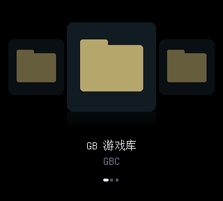

# Analogue Pocket CoverFlow Chinese Menu

The 2026-11-16 development batch adds [Pokémon Mini](docs/ADDITIONAL-CORES.md), bringing the preview to 18 native menu groups including WonderSwan / Color, Supervision, Atari 2600 / 7800, Arduboy and CPS1 / CPS1.5. Mini passes offline animation, transfer, compilation and independent SRAM review; device acceptance remains pending. Neo Geo's Chinese menu remains research without a fully verified installable package. Each menu retains its native FPGA engine and a separate launch entry. Enable **Settings → Analogue OS → Group openFPGA** to collect Chinese menus under **CN Menu**, alongside the original core categories.

`v0.5.0-preview.2` updates Windows artwork lookup: an unrecognized filename can use an unambiguous Chinese display alias, while conflicting names and ambiguous editions retain placeholders. The 18 core packages are unchanged. The frozen EXE passes independent prepare, install and rollback checks.

GBA `.10` adds image-upload synchronization and bounded recovery; SNES `.3` corrects the menu refresh rate; CPS2 `.3` repairs APF completion, path/save read timing and per-game instance configuration. All three CPS candidates also repair native EEPROM ERASE_ALL initialization. The installer blocks intermediate binaries rejected by protocol validation. Offline checks precede delivery; physical acceptance of these repairs and new cores is pending. Historical failures remain in [device feedback](docs/DEVICE-FEEDBACK-2026-11-03.md), the [GBA records](experiments/gba_coverflow/README.md) and [console experiments](experiments/console_coverflow/README.md).

The public stable release supports GB/GBC. Earlier GBA, NES and GG experiments have single-device launch feedback. See [development status](docs/COMPLETE-DELIVERY.md) for the current native previews, timing checks and hardware acceptance.

The [batch preflight, update and rollback tool](docs/BATCH-UPDATE.md) handles independent menu groups and retains existing settings and progress during refresh. New packages require corresponding sources and a reviewed build receipt.

[Build from your own filenames](docs/FILENAME-MENUS.md) scans existing game directories and uses each filename as its title by default. Missing artwork gets a text cover. Compatible core packages and the batch tool handle installation and refresh.

Native **openFPGA CoverFlow menus for Analogue Pocket**, with Unicode game titles, folders and a black background. Separate cores retain official Change Core navigation.

[简体中文](README.md) · [Releases](https://github.com/Sanssssssssssssssss/analogue-pocket-menu-cn/releases) · [Validation](docs/VALIDATION.md) · [Build](docs/BUILD.md) · [License](LICENSE.md)



This image is output from the actual menu RTL simulation, using synthetic entries. It is not a device photograph or evidence of game execution.

## Status

**v0.1.2-public.1 is the GB/GBC reference release.** Its bitstream is identical to the 0.1.2 lab build whose Chinese menu, GB/GBC launch and folder-transition flash fix were user-confirmed on a Pocket running Analogue OS 2.5. The 18 native menu groups and Windows assistant are separately published as **v0.5.0-preview.2**, a development preview whose added cores still need device acceptance.

- Chinese menu text and independent Unicode display titles, without renaming ROMs.
- Folder navigation: A opens, B returns, including at the root.
- Optional GB/GBC cover art, favorites controls and a Chinese pause menu.
- Local v9 library generation, installation plan, verified backup, file readback and rollback. The Windows assistant prepares locally and writes after **Backup and install**; the GB/GBC reference CLI uses `--apply`.
- Hardware acceptance covers the reported GB/GBC menu, folder navigation and game launch. The native previews require separate gameplay and save verification. Occasional flash and loading delay can occur at game handoff.

Historical records: the [GBA / NES / SNES interface experiments](experiments/multi_system/README.md) and [early standalone GBA integration](experiments/gba_menu/README.md) document earlier development. GBA `0.2.0-gba.3` received single-device menu and game-launch confirmation; that report does not certify the current preview candidates. The installable 18-group Windows preview is linked below. Ordinary saves, RTC, save-and-return and game compatibility require separate per-core acceptance.

Since 2026-11-01, the project has used [independent menus for each native core](docs/PER-SYSTEM-MENUS.md), retaining the official openFPGA system list and Change Core. Analogue OS home/settings translation and an automatic cross-core launcher are outside the current implementation.

## Install

For Windows, download `PocketLab-Windows-2026-11-16-preview2.zip` from the [18-core development preview](https://github.com/Sanssssssssssssssss/analogue-pocket-menu-cn/releases/tag/v0.5.0-preview.2), check the accompanying `SHA256SUMS.txt`, extract the whole folder and run `PocketLab.exe`. Python is included.

1. Keep your own ROMs under each platform's `Assets/<platform>/common/`, including subfolders. Select the newly connected card and a local workspace in the assistant.
2. Inspect systems, prepare the library, and review excluded files, artwork and ordinary-save matches. Filenames supply titles; optional aliases and covers are not required to build a menu.
3. Use **Backup and install**, then safely eject and insert the card into a powered-off Pocket. Open **openFPGA → CN Menu**; enable **Group openFPGA** in system settings if needed. Rebuild and update menus after adding, removing or renaming ROMs.

Supply your own games, external BIOS files and personal progress. Firmware is outside the update scope. See [supported platforms and save boundaries](docs/COMPLETE-DELIVERY.md).

The Windows assistant can import supported ordinary-save formats by ROM identity and create initial saves where required by a core. Existing target progress is preserved; conflicting sources require a choice. Instant states and suspend sessions are not converted across cores. File verification does not establish device acceptance of in-game saving, RTC or resume.

The commands below are for the **v0.1.2-public.1 GB/GBC reference release** and its `-core.zip`, separately from the Windows development preview above.

Use Python 3.11+, a microSD reader, your own GB/GBC ROMs and a 2304-byte GBC BIOS. No games, BIOS or saves are distributed.

1. Download **Source code** and the **`-core.zip`** from the same release tag. Check `SHA256SUMS.txt`, and extract the core ZIP locally into `dist/core`.
2. Run `python -m pip install -r requirements.txt` from the source directory.
3. Keep ROMs in `Assets/gb/common/` and `Assets/gbc/common/`, including subfolders. Replace `X:/` with the actual card root; macOS/Linux can use `/Volumes/Pocket` or the appropriate mounted path. Output and backups must be local folders outside the card.

```sh
python tools/build_library.py --card X:/ --out .work/library --bios X:/Assets/gbc/common/gbc_bios.bin
python tools/install.py --card X:/ --package dist/core --library .work/library
```

The installer defaults to a read-only plan. Back up `Saves` and `Memories` separately first, then apply with a new backup directory:

```sh
python tools/install.py --card X:/ --package dist/core --library .work/library --backup .work/backups/first-install --apply
```

Safely eject the card and insert it into the powered-off Pocket. Open **openFPGA → Pocket Lab GB-GBC → CoverFlow (pocketlab)**. This **GB/GBC reference `tools/install.py` workflow** updates only its core/assets/platform files and does not write save files or firmware.

In that reference workflow, new game progress lives in `Saves/gbclab/common` and old saves are not imported automatically; the Windows preview's ordinary-save handling is described above. To add display names, pass `--titles titles.json`, a UTF-8 object mapping a card-relative ROM path (such as `Assets/gbc/common/Example.gbc`) to its display title. For cover art use `--covers my-covers`, with matching card-relative paths and `.png` extensions. Neither changes original ROM names or content.

Rollback first previews, then applies:

```sh
python tools/install.py --card X:/ --backup .work/backups/first-install --rollback
python tools/install.py --card X:/ --backup .work/backups/first-install --rollback --apply
```

Rollback restores backed-up menu files and removes only unchanged files created by that installation. It retains current save files and refuses to replace manually changed menu files. For a simpler fallback, select your original GB/GBC core in Analogue OS. [Full Chinese guide](docs/INSTALL.zh-CN.md).

## Controls and development

These are the GB/GBC reference controls; consult the [per-core documentation](docs/COMPLETE-DELIVERY.md) for other preview cores. Left/right browse; A confirms; B goes up; X opens game actions; Select toggles favorites. In a game, L opens the Chinese pause overlay, B/L resumes. Saving and suspend/resume need additional hardware testing; use expendable progress first. The inherited “Enable GBA” option does not enable GBA ROM support.

Run `python -m unittest discover -s tests -v` and `python tools/check_repository.py`. Hardware changes require RTL regression, complete Quartus timing review and scoped device reports. See [Contributing](CONTRIBUTING.md), [Changelog](CHANGELOG.md), [Roadmap](docs/ROADMAP.md) and [License/credits](LICENSE.md).

Based on maxsorto's Cover Flow branch, budude2's Pocket port and the MiSTer Gameboy core. Existing component licenses remain in force. This project is not affiliated with Analogue, Nintendo or ModRetro.
