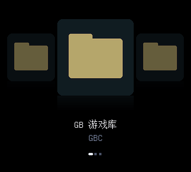

# Analogue Pocket CoverFlow Chinese Menu

This experimental branch also contains an [offline GBA / NES / SNES integration probe](experiments/multi_system/README.md). It validates native menu pages, loader contracts and standalone menu resources. It does not include an installable multi-system core or game execution.

The [machine icon menu](docs/MACHINE-MENU.md) uses the existing GB/GBC core: choose a machine illustration, then a category and game cover. An optional v9 restyler keeps existing game/save identities and groups classic shortcuts. The user has confirmed this layout works; this does not expand game/save coverage.

This branch also develops an [isolated full-core GBA integration](experiments/gba_menu/README.md). One Pocket user confirmed Chinese menus and game launch in `0.2.0-gba.3`; ordinary saves, RTC and save-return still await hardware acceptance. The stable release supports GB/GBC only.

As of 2026-11-01, the active direction is [separate visual menus for each platform](docs/PER-SYSTEM-MENUS.md): retain the official openFPGA platform list and Change Core, improve GB/GBC and GBA independently, then adapt other native cores individually. OS home-screen replacement and a merged cross-platform launcher are no longer active work.

New local work includes a [GBA slide candidate](experiments/gba_menu/MOTION.md), a [native NES menu candidate](experiments/nes_menu/README.md), and a [SNES prototype](experiments/snes_menu/README.md). GBA motion passed pixel, startup and game-raster comparisons, full compilation and 104 inherited timing records (minimum slack +0.080 ns). NES passed full compilation and 128 timing records (+0.126 ns) but awaits device testing and completed card-library staging. SNES timing failed, so no installable package is provided. None of these new candidates is installed or part of the stable release.

The GBA hardware trial reported `Error in core setup` before its menu appeared. The core folder/author/shortname mismatch has been corrected. Existing GB/GBC libraries can use the [display update tool](docs/DISPLAY-UPDATES.md) to add titles/covers while preserving game/save identities.

The [current GBA experiment](experiments/gba_menu/README.md) fixed the previous startup failure by initializing the lifecycle and acquiring frame ownership before painting. The user confirmed menu and game launch. The [display work](experiments/unified_frontend/README.md) stages Chinese captions, artwork and footer updates without changing launch/save records. The earlier shared Pocket Lab grouping was subsequently removed after backup, following the decision to retain separate platforms. Native icon-based automatic cross-core switching remains unimplemented.

A native **openFPGA GB/GBC cover-flow frontend for Analogue Pocket**, with Simplified Chinese controls, Unicode game titles, folders and a black background.

[简体中文](README.md) · [Releases](https://github.com/Sanssssssssssssssss/analogue-pocket-menu-cn/releases) · [Validation](docs/VALIDATION.md) · [Build](docs/BUILD.md) · [License](LICENSE.md)



This image is output from the actual menu RTL simulation, using synthetic entries. It is not a device photograph or evidence of game execution.

## Status

**v0.1.2-public.1 is a public preview.** Its bitstream is identical to the 0.1.2 lab build whose Chinese menu, GB/GBC launch and folder-transition flash fix were user-confirmed on a Pocket running Analogue OS 2.5. The new general-purpose packaging/install tools are tested with synthetic fixtures; multi-device validation is pending.

- Chinese menu text and independent Unicode display titles, without renaming ROMs.
- Folder navigation: A opens, B returns, including at the root.
- Optional cover art, favorites controls and a Chinese pause menu.
- Local v9 library generation, installation plan, verified backup, file readback and rollback.
- Known limitations: occasional flash when handing off to a game, loading delay, incomplete per-game/sound/save/pause testing. GBA and NES remain separate experiments; SNES has no installable candidate and automatic cross-core launching is unimplemented. Analogue OS menus remain outside this frontend.

## Install

Use Python 3.11+, a microSD reader, your own GB/GBC ROMs and a 2304-byte GBC BIOS. No games, BIOS or saves are distributed.

1. Download **Source code** and the **`-core.zip`** from the same release tag. Check `SHA256SUMS.txt`, and extract the core ZIP locally into `dist/core`.
2. Run `python -m pip install -r requirements.txt` from the source directory.
3. Keep ROMs in `Assets/gb/common/` and `Assets/gbc/common/`, including subfolders. Replace `X:/` with the actual card root; macOS/Linux can use `/Volumes/Pocket` or the appropriate mounted path. Output and backups must be local folders outside the card.

```sh
python tools/build_library.py --card X:/ --out .work/library --bios X:/Assets/gbc/common/gbc_bios.bin
python tools/install.py --card X:/ --package dist/core --library .work/library
```

The installer defaults to a read-only plan. Back up `Saves` and `Memories` separately first, then apply with a new backup directory:

```sh
python tools/install.py --card X:/ --package dist/core --library .work/library --backup .work/backups/first-install --apply
```

Safely eject the card and insert it into the powered-off Pocket. Open **openFPGA → Pocket Lab GB-GBC → CoverFlow (pocketlab)**. Installation is confined to the menu's core/assets/platform files. Save files and firmware are never written by the installer.

New game progress lives in `Saves/gbclab/common`; existing saves are not imported. To add display names, pass `--titles titles.json`, a UTF-8 object mapping a card-relative ROM path (such as `Assets/gbc/common/Example.gbc`) to its display title. For cover art use `--covers my-covers`, with matching card-relative paths and `.png` extensions. Neither changes original ROM names or content.

Rollback first previews, then applies:

```sh
python tools/install.py --card X:/ --backup .work/backups/first-install --rollback
python tools/install.py --card X:/ --backup .work/backups/first-install --rollback --apply
```

Rollback restores backed-up menu files and removes only unchanged files created by that installation. It retains current save files and refuses to replace manually changed menu files. For a simpler fallback, select your original GB/GBC core in Analogue OS. [Full Chinese guide](docs/INSTALL.zh-CN.md).

## Controls and development

Left/right browse; A confirms; B goes up; X opens game actions; Select toggles favorites. In a game, L opens the Chinese pause overlay, B/L resumes. Saving and suspend/resume need additional hardware testing; use expendable progress first. The inherited “Enable GBA” option does not enable GBA ROM support.

Run `python -m unittest discover -s tests -v` and `python tools/check_repository.py`. Hardware changes require RTL regression, complete Quartus timing review and scoped device reports. See [Contributing](CONTRIBUTING.md), [Changelog](CHANGELOG.md), [Roadmap](docs/ROADMAP.md) and [License/credits](LICENSE.md).

Based on maxsorto's Cover Flow branch, budude2's Pocket port and the MiSTer Gameboy core. Existing component licenses remain in force. This project is not affiliated with Analogue, Nintendo or ModRetro.
