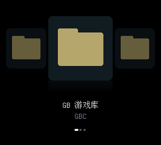

# Analogue Pocket CoverFlow 中文菜单

**为 Analogue Pocket 的 openFPGA GB / GBC 核心提供中文操作、中文游戏名和封面浏览。** 黑色背景，左右选游戏，A 进入，B 返回上级。

[English](README.en.md) · [下载公开预览版](https://github.com/Sanssssssssssssssss/analogue-pocket-menu-cn/releases) · [安装与回退](docs/INSTALL.zh-CN.md) · [验证范围](docs/VALIDATION.md) · [更新日志](CHANGELOG.md)



*预览来自实际菜单 RTL 仿真，使用自绘占位图和合成测试条目；不是掌机实拍，也不代表游戏运行验证。*

## 当前能用什么

| 功能 | 状态 |
|---|---|
| GB / GBC 中文操作、独立 Unicode 游戏标题 | 已实现；原开发环境实机确认中文菜单和游戏启动 |
| 子目录、A 进入、B 返回、首页返回 | 已实现；目录切换闪白修复已获实机确认 |
| 封面、收藏操作、中文暂停菜单 | 已实现；暂停保存／恢复仍需更多实机反馈 |
| 用户自己的 GB/GBC 目录与中文别名 | 公共 v9 生成器，读取原文件并在电脑生成菜单包 |
| 安装前计划、版本备份、回读校验、回退 | 有；默认仅预览，明确加 `--apply` 才写卡 |
| GBA / NES / SNES、全机种自动换核心 | 尚未实现，见[路线图](docs/ROADMAP.md) |
| Analogue OS 系统首页、系统设置汉化 | 不在当前功能范围；此界面运行于 GB/GBC 核心内 |

当前版本 **`v0.1.2-public.1`（公开预览）**。FPGA 程序与已经使用者验收的 `0.1.2-cn-lab` 相同；公开版新增通用打包／安装工具及文档。新工具已用合成文件测试，尚未完成多台 Pocket 实机验收。启动游戏偶尔短暂闪屏、加载稍慢仍是已知问题。

当前实验分支新增 [GBA / NES / SNES 接入实验](experiments/multi_system/README.md)：原生中文页面、加载接口检查和菜单模块资源验证。它尚未集成完整游戏核心，没有可安装的多机种版本。

本分支还提供[机种图标菜单](docs/MACHINE-MENU.md)：GB / GBC 掌机图标 → 分类 → 原有游戏封面，经典系列集中在收藏入口。可复用稳定核心；新布局待实机反馈。

## 快速开始

需要 Analogue Pocket、microSD 读卡器、Python 3.11+，以及你自己的 GB/GBC ROM 和 2,304 字节 GBC BIOS。原实机报告使用 Analogue OS 2.5；其他固件版本未在此项目逐一验证。本项目不提供游戏、BIOS 或个人存档。

1. 从 [Releases](https://github.com/Sanssssssssssssssss/analogue-pocket-menu-cn/releases) 下载同一标签的 **Source code** 和 **`-core.zip`**，将核心压缩包在电脑解压到 `dist/core`。用 `SHA256SUMS.txt` 核对下载文件。
2. 在源码目录执行 `python -m pip install -r requirements.txt`。
3. 保留 ROM 在 `Assets/gb/common/` 或 `Assets/gbc/common/`，支持其下子目录。把下面的 `X:/` 换成重新确认的卡盘符；`--out` 必须位于电脑上。

```powershell
python tools/build_library.py --card X:/ --out .work/library --bios X:/Assets/gbc/common/gbc_bios.bin
python tools/install.py --card X:/ --package dist/core --library .work/library
```

第二条只生成安装计划。先备份 `Saves` 和 `Memories`，确认计划与卡无误后执行：

```powershell
python tools/install.py --card X:/ --package dist/core --library .work/library --backup .work/backups/first-install --apply
```

安装完成后安全弹出卡，Pocket 关机后插卡，从 **openFPGA → Pocket Lab GB-GBC → CoverFlow（pocketlab）** 进入。完整的 Windows / macOS / Linux 路径说明、中文名、封面、存档与回退见[安装指南](docs/INSTALL.zh-CN.md)。

安装工具只更新 `Cores/pocketlab.CoverFlow`、`Assets/gbclab/common` 和两个 `gbclab` 平台文件；不会写入固件或任何存档文件。新生成的游戏进度使用 `Saves/gbclab/common`，原 GB/GBC 存档不会自动导入。

## 操作

| 按键 | 功能 |
|---|---|
| 左／右 | 浏览条目 |
| A | 打开目录／启动游戏／确认 |
| B | 返回上级；首页保持首页 |
| X | 游戏条目操作菜单 |
| Select | 全部／收藏筛选 |
| L（游戏中） | 中文暂停菜单；B / L 继续 |

暂停层“返回菜单”涉及实验目录的存档和休眠写入；请先用非重要进度验证。`Enable GBA` 是 GB/GBC 核心的兼容标识设置，不能运行 GBA 游戏。

## 开发与来源

- [构建核心](docs/BUILD.md)：Quartus 22.1、完整硬件源码、已验证 bitstream 哈希及资源／时序范围。
- [数据格式](docs/FORMAT.md)：v9 中文文字层、目录末尾的返回入口、原 ROM 路径与独立存档映射。
- [贡献指南](CONTRIBUTING.md)：测试、错误报告和功能范围；提交问题时请勿上传游戏、BIOS、存档或整卡清单。
- [许可证与署名](LICENSE.md)：继承 maxsorto Cover Flow、budude2 / MiSTer Gameboy、Analogue APF 及 GNU Unifont，保留各自条款。本项目与 Analogue、Nintendo、ModRetro 无隶属关系。

```powershell
python -m unittest discover -s tests -v
python tools/check_repository.py
```

本项目面向 **Analogue Pocket 中文菜单 / openFPGA 汉化前端 / Game Boy 与 Game Boy Color 中文游戏库**；English keywords: **Analogue Pocket, openFPGA, Game Boy, Game Boy Color, GB, GBC, Chinese UI, Simplified Chinese, Unicode titles, CoverFlow, FPGA frontend**。
