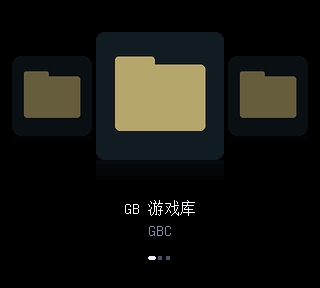

# Analogue Pocket CoverFlow 中文菜单

**为 Analogue Pocket 的原生 openFPGA 核心提供中文游戏名、分类和 CoverFlow 封面浏览。** 黑色背景，左右选游戏，A 进入，B 返回上级。各机种独立启动，保留官方 Change Core。

[English](README.en.md) · [下载公开预览版](https://github.com/Sanssssssssssssssss/analogue-pocket-menu-cn/releases) · [安装与回退](docs/INSTALL.zh-CN.md) · [验证范围](docs/VALIDATION.md) · [更新日志](CHANGELOG.md)

2026-11-16 开发批次加入 [Pokémon Mini](docs/ADDITIONAL-CORES.md)，与 WonderSwan / Color、Supervision、Atari 2600 / 7800、Arduboy、CPS1 / CPS1.5 等组成 18 组原生中文菜单。Mini 已通过离线动画、读写、编译和独立 SRAM 复核，实机仍待验收。Neo Geo 的中文菜单继续研究，尚无通过完整检查的安装包。CN 菜单可用官方分类集中显示：**Settings → Analogue OS → Group openFPGA → On**，然后进入 **CN Menu**。

`v0.5.0-preview.2` 更新 Windows 助手的封面匹配：原文件名未识别时，可用唯一对应作品的中文别名补查；同名冲突和多版本图片继续保留占位图。18 组核心与前一预览版相同，实际 EXE 的准备、安装和回退已通过独立检查。

GBA `.10` 增加图像上传同步与有限重试；SFC `.3` 修正菜单刷新率；CPS2 `.3` 修正 APF 完成握手、文件路径与存档读取时序，以及每次启动的实例配置。三个 CPS 候选还修正了原生 EEPROM 全片擦除的初始化遗漏。已被协议验证拒绝的中间位流会被安装助手拦截。新修复和新增核心经过离线检查后交付，实机效果仍待确认。历史失败版本与检查边界保留在[设备反馈](docs/DEVICE-FEEDBACK-2026-11-03.md)、[GBA 记录](experiments/gba_coverflow/README.md)及[主机核心记录](experiments/console_coverflow/README.md)。公开稳定二进制仍限 GB/GBC。



开发分支的[整批预检、更新与回退](docs/BATCH-UPDATE.md)支持独立核心，刷新时沿用已有显示和进度。安装助手只接受带有对应源码和已核对收据的新增核心包。

[用自己的文件名建库](docs/FILENAME-MENUS.md)可直接扫描已有游戏目录。中文文件名直接显示，缺图生成文字封面。建库后用匹配的核心包进行整批安装或刷新。

*预览来自实际菜单 RTL 仿真，使用自绘占位图和合成测试条目；不是掌机实拍，也不代表游戏运行验证。*

## 当前能用什么

| 功能 | 状态 |
|---|---|
| GB / GBC 中文操作、独立 Unicode 游戏标题 | 已实现；原开发环境实机确认中文菜单和游戏启动 |
| 子目录、A 进入、B 返回、首页返回 | 已实现；目录切换闪白修复已获实机确认 |
| GB/GBC 封面、收藏操作、中文暂停菜单 | 已实现；暂停保存／恢复仍需更多实机反馈 |
| 用户自己的 GB/GBC 目录与中文别名 | 公共 v9 生成器，读取原文件并在电脑生成菜单包 |
| 安装前计划、版本备份、回读校验、回退 | Windows 助手先在电脑预检，点击“备份并安装”后写卡；GB/GBC 基础版 CLI 使用 `--apply` 执行计划 |
| GBA / NES / Sega / PCE / MD / SFC / CPS2 | 独立开发候选，分别从 openFPGA 进入。支持范围和实机进度见[各机种状态](docs/COMPLETE-DELIVERY.md)。 |
| WS / Supervision / Atari / Arduboy / CPS1 / CPS1.5 / Pokémon Mini | 新增原生开发候选；游戏目录、存档边界和分类方法见[说明](docs/ADDITIONAL-CORES.md)。 |
| Analogue OS 系统首页、系统设置汉化 | 不在当前功能范围；中文菜单运行于各机种的独立核心内 |

GB/GBC 基础版为 **`v0.1.2-public.1`**，FPGA 程序与已获单机验收的 `0.1.2-cn-lab` 相同。18 组原生菜单和 Windows 助手作为 **`v0.5.0-preview.2` 开发预览**单独发布，新增核心仍需实机验收。启动游戏时的短暂闪屏和加载延迟不能据此宣称全部解决。

历史记录：[GBA / NES / SNES 接口实验](experiments/multi_system/README.md)和[早期独立 GBA 核心接入](experiments/gba_menu/README.md)保留开发过程。`0.2.0-gba.3` 曾获单机中文菜单与游戏启动确认；这份旧版反馈不代表当前预览候选的完整验收。当前可安装的 18 组 Windows 开发预览见下方下载，普通存档、RTC、保存返回和游戏兼容性仍按机种分别记录与验收。

项目自 2026-11-01 起采用[各机种独立的中文可视化菜单](docs/PER-SYSTEM-MENUS.md)：保留官方 openFPGA 的机种列表及 Change Core，逐个适配原生核心。系统首页和跨机种合并启动器的研究已收束。

共用 CoverFlow 的 NES `.2` 通过 128 条时序检查，最小余量 +0.056 ns，已有单机使用反馈。旧的[GBA 整页滑动](experiments/gba_menu/MOTION.md)、[NES 静态页](experiments/nes_menu/README.md)及[SFC 初版原型](experiments/snes_menu/README.md)保留为开发记录。

GB/GBC 的[机种图标菜单](docs/MACHINE-MENU.md)提供掌机图标 → 分类 → 原有游戏封面，经典系列集中在收藏入口。复用稳定核心，用户已确认该布局可用。

已有 GB/GBC 菜单可用[显示素材更新工具](docs/DISPLAY-UPDATES.md)补中文名和封面，保留原游戏／存档关联。GBA 的[素材工具](experiments/unified_frontend/README.md)另提供中文标题、封面和底部提示更新。当前采用独立机种核心加 CN Menu 分类；中文图标页内自动切换核心尚未实现。

## 快速开始

Windows 用户下载 [18 组核心开发预览](https://github.com/Sanssssssssssssssss/analogue-pocket-menu-cn/releases/tag/v0.5.0-preview.2)中的 `PocketLab-Windows-2026-11-16-preview2.zip`，核对同页 `SHA256SUMS.txt`，完整解压后运行 `PocketLab.exe`，无需安装 Python。

1. 把自备 ROM 放在相应 `Assets/<平台>/common/` 下，可使用子文件夹；在助手中选择本次连接的卡与电脑工作目录。
2. 识别机种，准备游戏库并查看排除项、图文和旧存档报告。中文文件名直接显示；封面与别名可选，不含这些资料也能建库。
3. 点击“备份并安装”。完成后安全弹出，Pocket 关机插卡，从 **openFPGA → CN Menu** 进入；若未分组，在系统设置打开 **Group openFPGA**。新增、删除或改名 ROM 后，用助手重新准备并更新菜单。

游戏、外部 BIOS 和个人存档由使用者自备。原固件不参与更新。详细支持范围、普通存档和原作者兼容入口见[完整交付说明](docs/COMPLETE-DELIVERY.md)。

Windows 助手可按 ROM 身份导入已支持格式的普通存档，并按机种创建必要的初始存档。已有目标进度保留原样，冲突会要求选择来源；即时存档和休眠现场不做跨核心转换。文件校验通过不代表游戏内保存、RTC 或恢复功能已获实机验收。

以下命令保留给 **GB/GBC 基础版 `v0.1.2-public.1`**；下载该标签的 `-core.zip`，不要与上面的 Windows 开发预览混用。

需要 Analogue Pocket、microSD 读卡器、Python 3.11+，以及你自己的 GB/GBC ROM 和 2,304 字节 GBC BIOS。原实机报告使用 Analogue OS 2.5；其他固件版本未在此项目逐一验证。本项目不提供游戏、BIOS 或个人存档。

1. 从 [Releases](https://github.com/Sanssssssssssssssss/analogue-pocket-menu-cn/releases) 下载同一标签的 **Source code** 和 **`-core.zip`**，将核心压缩包在电脑解压到 `dist/core`。用 `SHA256SUMS.txt` 核对下载文件。
2. 在源码目录执行 `python -m pip install -r requirements.txt`。
3. 保留 ROM 在 `Assets/gb/common/` 或 `Assets/gbc/common/`，支持其下子目录。把下面的 `X:/` 换成重新确认的卡盘符；`--out` 必须位于电脑上。

```powershell
python tools/build_library.py --card X:/ --out .work/library --bios X:/Assets/gbc/common/gbc_bios.bin
python tools/install.py --card X:/ --package dist/core --library .work/library
```

第二条只生成安装计划。先备份 `Saves` 和 `Memories`，确认计划与卡无误后执行：

```powershell
python tools/install.py --card X:/ --package dist/core --library .work/library --backup .work/backups/first-install --apply
```

安装完成后安全弹出卡，Pocket 关机后插卡，从 **openFPGA → Pocket Lab GB-GBC → CoverFlow（pocketlab）** 进入。完整的 Windows / macOS / Linux 路径说明、中文名、封面、存档与回退见[安装指南](docs/INSTALL.zh-CN.md)。

以上 **GB/GBC 基础版 `tools/install.py`** 只更新 `Cores/pocketlab.CoverFlow`、`Assets/gbclab/common` 和两个 `gbclab` 平台文件，不写入固件或存档。该流程的新进度使用 `Saves/gbclab/common`，不自动导入旧 GB/GBC 存档；Windows 开发预览的普通存档处理见上方说明。

## 操作

以下为 GB/GBC 基础版操作；开发预览的其他核心以[各机种说明](docs/COMPLETE-DELIVERY.md)为准。

| 按键 | 功能 |
|---|---|
| 左／右 | 浏览条目 |
| A | 打开目录／启动游戏／确认 |
| B | 返回上级；首页保持首页 |
| X | 游戏条目操作菜单 |
| Select | 全部／收藏筛选 |
| L（游戏中） | 中文暂停菜单；B / L 继续 |

暂停层“返回菜单”涉及实验目录的存档和休眠写入；请先用非重要进度验证。`Enable GBA` 是 GB/GBC 核心的兼容标识设置，不能运行 GBA 游戏。

## 开发与来源

- [构建核心](docs/BUILD.md)：Quartus 22.1、完整硬件源码、已验证 bitstream 哈希及资源／时序范围。
- [数据格式](docs/FORMAT.md)：v9 中文文字层、目录末尾的返回入口、原 ROM 路径与独立存档映射。
- [贡献指南](CONTRIBUTING.md)：测试、错误报告和功能范围；提交问题时请勿上传游戏、BIOS、存档或整卡清单。
- [许可证与署名](LICENSE.md)：继承 maxsorto Cover Flow、budude2 / MiSTer Gameboy、Analogue APF 及 GNU Unifont，保留各自条款。本项目与 Analogue、Nintendo、ModRetro 无隶属关系。

```powershell
python -m unittest discover -s tests -v
python tools/check_repository.py
```

本项目面向 **Analogue Pocket 中文菜单 / openFPGA 汉化前端 / Game Boy 与 Game Boy Color 中文游戏库**；English keywords: **Analogue Pocket, openFPGA, Game Boy, Game Boy Color, GB, GBC, Chinese UI, Simplified Chinese, Unicode titles, CoverFlow, FPGA frontend**。
