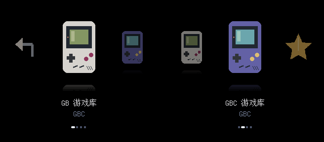

# Machine icons / 机种图标菜单

2026-10-31。此分支的 **GB/GBC 图标菜单可以由现有核心显示并选择游戏**，使用同一套已经验收的 GB/GBC bitstream。新布局仍待本轮实机反馈。GBA、FC/NES、SFC/SNES 继续属于离线接入实验；绘制了机种图标不等于实现了对应游戏核心。



黑底保留。首页左右选择 **GB / GBC / 经典收藏**，A 进入，B 返回上级；游戏页继续显示原有封面。收藏页只有原库确有经典快捷入口时才生成。原有游戏列表、版本、普通存档与即时存档路径保持对应。类型目录使用格斗手套、剑盾、益智方块等原创像素图标。图片使用原来的 128 / 80 像素 RGB565 缓存格式，包大小与每条目缓存大小相同；没有增加 FPGA 视频逻辑。

截图是实际菜单 RTL 的输出，APF 和 SDRAM 由测试模型提供。它展示菜单渲染，不是实机照片或游戏运行证明。公开截图只含原创机种图案。

[验证收据](build/machine-menu-validation.json)：Linux 22 项检查通过；Windows 通过 21 项、跳过 1 项符号链接检查。原菜单 RTL 检查 3 个完整画面、缓存内容及机种／经典系列的进入返回；新布局待本轮实机确认。

## 新建游戏库

`tools/build_library.py` 自动为 GB、GBC 和已知类型目录生成图标，并将 `3.FTG` 等常用目录显示为中文。用 `--covers` 提供的游戏封面继续生效。新建库仍使用公开版的隔离存档规则，不会自动迁移旧进度，见[安装说明](INSTALL.zh-CN.md)。

## 保留现有 v9 游戏库与进度

已有 v9 菜单时，使用专用工具保留原游戏条目。不要为更换图标重算 ROM 身份或存档文件名。将 `X:/` 换成刚确认的卡；输出必须在电脑上：

```powershell
python tools/style_library.py --card X:/ --out .work/machine-library
python tools/install.py --card X:/ --package dist/core --library .work/machine-library
```

第二条仅显示计划。`dist/core` 使用与当前核心相符的完整核心包；工具检查原菜单快照，拒绝已经变化的输入卡。源目录仅用于读取；不在卡上复制 ROM。

确认计划、备份当前进度后使用已有安装器：

```powershell
python tools/install.py --card X:/ --package dist/core --library .work/machine-library --backup .work/backups/machine-icons --apply
```

安装器先备份被覆盖文件并核对，再发布新子页、旧页和首页，写后回读 SHA-256。回退使用同一备份，不覆盖之后的新进度：

```powershell
python tools/install.py --card X:/ --backup .work/backups/machine-icons --rollback --apply
```

此工具支持首页全为目录、带有 `GB ` / `GBC ` ASCII 备用标题的 v9 库；不自动修复不完整菜单、扩展包或其他前端格式。已完成同款分组的库会被拒绝重复改组。对电脑卡副本生成的结果绑定该副本；写入实体卡前应针对实体卡重新生成和预览计划。

## Native rendering preview

Linux/WSL 需要 Verilator。对电脑上生成的单页（最多 1 MiB）执行：

```sh
python tools/preview_menu.py --pack .work/machine-library/Assets/gbclab/common/covers.bin --out .work/machine-preview --views 2
sh .work/machine-preview/run.sh
```

生成的 `view-0.ppm` / `view-1.ppm` 来自未改动的实际 `cover_picker.sv`。测试检查每帧 320×288 像素、SDRAM 封面缓存内容与输入包逐字一致，以及渲染时游戏保持复位。`simulation.log` 不代表游戏或真实保存验证。

## 接入其他机种需要完成什么

1. 给一个完整游戏核心接入页面读取、图标缓存、输入和视频切换，先完成该机种内的选游戏体验。
2. 将 ROM、BIOS、mapper、普通存档和 RTC 接到真实加载地址；返回前等待进度写盘完成。
3. 完成全核心综合、时序检查和独立入口的实机验证，覆盖启动、游玩、保存、重开及错误退出。
4. 统一入口另需解决菜单唤起宿主加载器及跨 bitstream 返回；目前[官方 Target 命令](https://www.analogue.co/developer/docs/openfpga/host-target-commands)没有通用换核心操作，[Chip32](https://www.analogue.co/developer/docs/openfpga/chip32-vm/initialization-of-the-chip32-vm)也不常驻运行。当前采用逐核心适配路线，换机种阶段性仍由 Analogue OS 完成。

下一台机种优先 GBA：需要接入 BIOS、SRAM / Flash / EEPROM 存档、独立 RTC，并解决已发现的重载事务边界。NES、SNES 在同一导航与数据契约上继续接入；SNES 必须保留原加载器选核。当前没有 GBA/NES/SNES 可安装菜单包。

## English

This branch adds original machine/genre pixel icons to the existing **GB/GBC** menu without changing its hardware source. The optional v9 restyler retains game records and save paths, groups classic shortcuts under a separate page, and rewires their parent links. Native screenshots use real menu RTL with APF/SDRAM models. Hardware acceptance of the new layout is pending. GBA/NES/SNES icons and loader experiments do not implement runnable multi-system support.
