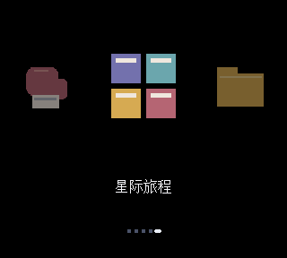

# 共用原版 CoverFlow

从已获 GB/GBC 实机反馈的 `core/src/core/cover_picker.sv` 提取绘制逻辑，各机种适配自己的资源加载、存档及视频接口。冻结的 135 份核心输入保持原样。



此动画使用原项目自绘图标与合成标题，由菜单 RTL 输出；不是掌机实拍或游戏运行证据。

复用内容包括独立封面移动／缩放、八帧缓动、明暗、圆角、倒影、标题渐显／跑马灯、页码，以及原有缓存预取顺序。没有用整页图片模拟封面移动。标题和下方一行均可使用 Unicode 字形列。

新适配器为视频增加像素使能，并将固定延迟的 SDRAM 读取换成请求／响应接口。扫描行完成后才交给显示；取消、超时或退出时保留尚未结束的读取归属，迟到的数据不会成为有效封面。GBA 在桥接时钟下计算纹理坐标，以单请求握手连接原内存时钟。可选紧凑几何表由原始 RTL 的 17 个数值姿态生成，省去重复乘法；动画状态和数值对照均单独验证。

原绘制的离屏裁切算式混合了有符号坐标和无符号步长，会把负坐标零扩展，读到错误纹理。新读取器先计算正确的裁切距离。冻结源码不变；差分光栅的参考副本仅为这一条算式添加显式有符号转换，原问题另由实际冻结模块和 Intel 模型复现记录。

## 验证范围

- 原公式及紧凑几何表均与实际冻结模块比较：每套覆盖 8 种数量边界、96 次双向／环绕切换，84,864 组封面参数一致。
- 在 Icarus 中对照真实 Intel RAM 模型校准模拟内存：8,871 次采样，包含 16 位图像／字形、12 位标签、不同时钟和读使能保持。Verilator 与原厂 RAM 模型不兼容，早先未断言缓存写入的快速结果不作为验收依据。
- 真实纹理／中文字形及连续八帧动画与上述明确修正的参考副本比较：10 个完整光栅帧、1,122,000 次含消隐区比较；紧凑几何表和 74 MHz／100 MHz 握手版本均通过。检查姿态已建立、缓存已写入、扫描行按时完成、像素使能和物理同步脉冲。
- 跨时钟读取桥覆盖 65 次请求、可变延迟、数据／地址保持、未归属完成信号和重复请求。
- 另有正向早期、反向中途／结束的完整双向纹理用例，在实际 GBA 时钟桥配置下通过。
- 读取适配器覆盖可变延迟、取消后迟到的响应、禁用再启用、超时保持归属及显式恢复。

这些是合成资源的 RTL 检查，不包含游戏 CPU、实体 SDRAM／SD 卡或掌机验收。每个机种仍需完整布局布线、时序检查和实机测试。GBA 集成见[适配说明](../gba_coverflow/README.md)，最终交付要求见[总目标](../../docs/COMPLETE-DELIVERY.md)。

```sh
python experiments/coverflow_shared/prepare_view.py --out .work/coverflow-view
python experiments/coverflow_shared/probe_geometry.py --out .work/geometry-check --intel-model /licensed/altera_mf.v
python experiments/coverflow_shared/probe_view.py --out .work/raster-check --intel-model /licensed/altera_mf.v
iverilog -g2012 -s tb_line_fetch -o .work/line-check experiments/coverflow_shared/line_fetch.sv experiments/coverflow_shared/tb_line_fetch.sv
vvp .work/line-check
```

仿真需 Linux／WSL、Icarus、Verilator 和自行安装的 Intel 仿真库。第三方仿真库不随仓库发布。提取前校验原始模块 SHA-256；生成目录必须是新的 `.work` 子目录。继承代码来自 [maxsorto/openfpga-GBC](https://github.com/maxsorto/openfpga-GBC/tree/666c4f33b70880047ab9e0a1987fa439ebfd78bb)，保留其 [MIT 声明](../../LICENSES/UPSTREAM-NOTICE.txt)；没有重新许可原生游戏核心。

独立 CellRAM 后端见[世嘉适配](../sega_coverflow/README.md)：复用固定 GBA 源码的 MIT PSRAM 驱动，只用原先空闲的 RAM bank。`prepare_psram.py` 生成单独的 16 位读取变体，不改变已编译 GBA 的默认生成输入。行为模型检查突发上传和并发读取，实体 RAM 仍待验收。

## English

The [NES adapter](../nes_coverflow/README.md) adds a separate five-slot associative cache while retaining the same candidate wrapping, geometry and raster. Its packed independent art RAM and deliberately permuted logical-to-physical mapping pass complete raster comparisons. This adapter does not alter the default GBA-generated module.

This extracts the accepted GB/GBC CoverFlow compositor and cache ordering into isolated build inputs. Independent cover movement, scaling, brightness, rounded corners, reflections, title fade/marquee and page indicators are retained. A ready/response texture transport, completed-line guard, clock bridge, optional original-RTL pose table and Unicode bitmap rows adapt it to other native cores. The 135 accepted inputs remain unchanged. The new transport corrects an upstream signed-clipping bug; the raster reference copy documents that one expression change. Portable simulation RAM is crosschecked against real Intel models in Icarus, since direct use of those models in Verilator did not exercise writes correctly. Ten-frame raster checks include explicit pose/cache assertions and the asynchronous bridge. These synthetic tests do not establish game execution, physical memory timing or device acceptance.
