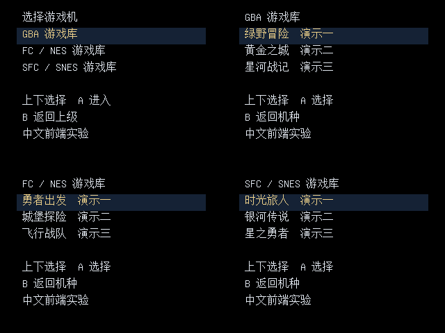

# GBA / NES / SNES 中文菜单接入实验

2026-10-31。**这是电脑实验，尚无可安装的多机种核心。** 已实现可综合的原生中文页面、导航和只读加载命令状态机，并验证三个候选核心的加载接口。GB/GBC 稳定版保留在 `main` / `v0.1.2-public.1`。



画面由实际 `menu_shell.sv` 仿真产生，使用合成条目。没有模拟游戏画面，也没有游戏 CPU。选择一个机种后显示对应中文页；上下选择、A 选择、B 返回首页；失败可返回。

## 验证到哪里

| 部分 | 已完成 | 尚未完成 |
|---|---|---|
| 共用中文菜单 | 4 KiB 页面缓存、完整页提交、黑屏加载、同步视频、选项与 B 返回 | 真实 APF 页面加载服务、任意大小游戏库、封面 |
| GBA | ROM 头校验、存档／RTC 独立路径、槽位核对；真实入口 RTL 的字节序、地址、等待与完成检查 | 新游戏事务重载、BIOS／存档全流程、CPU 接入 |
| NES / FC | iNES / NES 2.0 普通尺寸、trainer 保留、mapper 编号提取；真实入口 RTL 验证 | mapper 逐款兼容、存档写回、CPU 接入 |
| SNES / SFC | 原上游 Chip32 汇编后跑 LoROM、HiROM、ExHiROM、PAL、S-DD1、SPC7110 和 copier header 七种用例 | 真实 FPGA 重配置、宿主唤起、完整核心与游戏测试 |
| FPGA 资源 | 菜单单独在 `5CEBA4F23C8` 完成 Quartus 编译／布局布线；124 ALM、4 M10K、0 DSP | 三种游戏核心与菜单合并后的资源和时序 |

18 项容器／存档映射测试、11 项加载保护测试、三机种页面与错误返回仿真通过。GBA/NES 使用冻结上游模块和本机 Intel FIFO 模型；SNES 使用真实原作者加载程序，但 VM 的 CORE/HOST/PMPW/LOADF 只记录宿主操作，**不执行 FPGA 或游戏**。

资源试验采用 100 MHz 约束，最差 setup 2.490 ns，所有报告的 TNS 为 0。时钟使用 Pocket 的 `PIN_V15`，其余 86 个接口采用虚拟引脚。它仅用于模块资源／时序评估，生成的 SOF **不能写入 Pocket**。原始摘要见 [fit](evidence/menu_probe.fit.summary)、[timing](evidence/menu_probe.sta.summary)，[验证收据](evidence/validation.json)记录输入哈希。

## 实测发现的边界

- GBA 当前上游 `apf_write_ingress.sv` 在启动完成后再次送 ROM，会触发 `APF startup write arrived after completion fence`。这是 `translate_off` 内的仿真断言，不能据此断言硬件一定失败；必须明确新一轮加载的事务边界并重新验证。该负向观察保留在[入口收据](evidence/ingress.json)。
- SNES 必须保留宿主加载器选核，不能固定把全部 ROM 交给 main bitstream。新 `launch_guard` 对 SNES 返回“需要宿主加载器”，防止走错误的 GBA/NES 直读流程。
- 64 KiB SNES 合成文件在原加载器／VM 组合中出现末尾读取越界，截断文件也被拒绝；尚未验证实体 Pocket 对这些边界的行为，见[加载器收据](evidence/snes-loader.json)。
- 新菜单的 `launch_request` 只输出请求；`launch_guard` 独立验证命令顺序。它们尚未接成完整 APF／游戏核心链路。没有普通存档、声音、游戏兼容或实机返回菜单的完成声明。

## 复现

从仓库根目录执行，输出均在电脑 `.work`；每次需要新的输出目录。依赖 Python 3.11+、本仓库 `requirements.txt`，RTL 仿真另需 Icarus Verilog。

```sh
python -m pip install -r requirements.txt
python -m unittest discover -s experiments/multi_system -p 'test_*.py' -v
python experiments/multi_system/prepare_pages.py --out .work/multi-system/rtl
sh experiments/multi_system/run_rtl.sh
python experiments/multi_system/fetch_sources.py --out .work/multi-system/sources
python experiments/multi_system/launch_plan.py --check-upstream .work/multi-system/sources
```

生成某个本地 ROM 的只读规划，可执行 `python experiments/multi_system/launch_plan.py --platform gba --rom /path/to/own-game.gba`。输出的 `deployable` 固定为 `false`；不安装、不移动文件、不操作设备存档。

上游入口测试需要你本机合法安装 Quartus 提供的 `eda/sim_lib/altera_mf.v`；模型不随仓库分发：

```sh
python experiments/multi_system/probe_ingress.py --sources .work/multi-system/sources --intel-model /path/to/altera_mf.v --out .work/multi-system/ingress-check
```

SNES 测试需要 [BASS](https://github.com/ARM9/bass/tree/828ad2c11bddac45c7daeba9293a5265f2994bd5)、[Chip32 指令定义](https://github.com/open-fpga/bass-chip32/tree/9e4a919d1ff39b217b75e090e996148654d3f9d7)（放在 BASS 可执行文件旁的 `architectures/chip32.vm.arch`），以及 [Chip32 VM](https://github.com/agg23/openfpga-chip32-sim/tree/c358d70263383a133fcd303b19c3e559caf33c8b) 的 `chip32-sim-cli`：

```sh
python experiments/multi_system/probe_snes_loader.py --sources .work/multi-system/sources --bass /path/to/bass --simulator /path/to/chip32-sim-cli --out .work/multi-system/snes-check
python experiments/multi_system/prepare_fit.py --out .work/multi-system/menu-fit
cd .work/multi-system/menu-fit
quartus_sh --flow compile menu_probe.qpf
```

最后一项只构建菜单模块；检查 fitter 与所有 timing models 的报告，不能仅看编译命令退出码。本轮曾发现并修复像素颜色路径的时序失败，保持 100 MHz 约束，通过行计数器和 RGB／同步信号的同级寄存器改善时序。

## 来源与下一步

- [mincer-ray GBA](https://github.com/mincer-ray/openfpga-GBA/tree/a61eaf2e8d50631f5dd32bda5c84229a0c54ab78)
- [agg23 NES](https://github.com/agg23/openfpga-NES/tree/be5f1303a0df15d012155cb248b6174bb81e64b6)
- [agg23 SNES](https://github.com/agg23/openfpga-SNES/tree/1a08c84ddef760bedd30a376114fc2e97527df19)

提交及原始 ZIP 哈希固定于 [profiles.json](profiles.json)。`fetch_sources.py` 保留原始下载并校验路径与大小。

下一步先完成一个核心的真实闭环：加载页面 → 绑定 ROM／存档 → 运行 → 写盘完成 → 返回，再推广到其他核心。[官方 Target 接口](https://www.analogue.co/developer/docs/openfpga/host-target-commands)目前没有通用“启动另一个已安装核心”命令；本实验没有绕过这一缺口。真机试用应采用独立实验入口和存档副本。

## English

This branch contains an **offline experiment, not an installable multi-system frontend**. It includes a synthesizable Chinese menu shell, launch-command guards, GBA/NES/SNES container contracts, tests of actual upstream GBA/NES input modules, and seven actual SNES Chip32 loader scenarios. All fixtures are synthetic; no games, BIOS or saves are distributed.

The standalone menu uses 124 ALMs and four M10Ks on the Pocket's FPGA. Its 100 MHz timing probe passes with 2.490 ns minimum setup slack, using 86 virtual interface pins. This does not establish the resource/timing budget of a combined game core. No game CPU, real save writeback, hardware reconfiguration or physical-device validation has been completed. The stable GB/GBC release remains unchanged.
